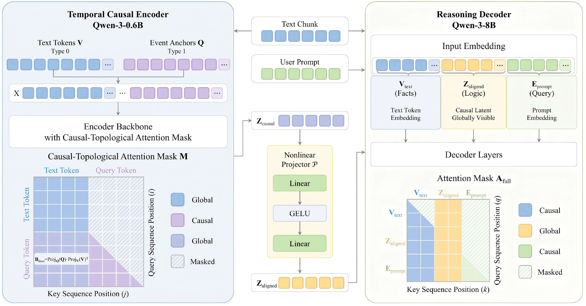

# TCR-Former: From Document Layout to Causal Topology

Official code for the paper **"From Document Layout to Causal Topology: An End-to-End Architecture for Temporal Causal Reasoning"**, accepted at the **40th Conference on Neural Information Processing Systems (NeurIPS 2026)**.

## Overview

Large language models (LLMs) generally lack deep causal reasoning capabilities in temporal reasoning. Inspired by document layout reordering, this work proposes a paradigm shift from discrete narratives to **causal topologies**, and constructs two architectures:

- **TCR-Agent**: a training-free neuro-symbolic framework that achieves interpretable causal deduction and counterfactual truncation through external causal graph instantiation and a symbolic intervention engine.
- **TCR-Former**: an end-to-end model that internalizes these mechanisms into the Transformer attention space via a **Causal-Topological Attention Mask**, explicit **temporal span biases**, and a **native counterfactual intervention** mechanism.

On the **TempoCausal-Bench** benchmark, TCR-Former achieves an accuracy **16.5% higher** than state-of-the-art methods, outperforming large-scale models such as GPT-5.4 and DeepSeek-V3.2 with only ~8.6B parameters.

## Code Description

The code implements the **TCR-Former** architecture:

- **`encoder.py`** — The Temporal Causal Encoder built on Qwen-3-0.6B. It introduces learnable event anchor query tokens with time span bias embeddings, applies the causal-topological attention mask (bidirectional attention among text tokens, causal ordering among event queries), adds a time-aware positional bias, and is supervised by an auxiliary timestamp regression loss.
- **`decoder.py`** — The Reasoning Decoder built on Qwen-3-8B. It aligns the encoder's causal latent variables through a nonlinear projector and performs autoregressive generation with a block-diagonal attention mask over the fact track, logic track, and prompt track.
- **`pipeline.py`** — The end-to-end forward computation flow, including native counterfactual intervention (resolving the intervention target from the query prompt and pruning the attention mask at the target event anchor).
- **`config.py`** — Configuration of default backbone models and checkpoint paths (encoder checkpoint, projector checkpoint, and decoder LoRA directory).

